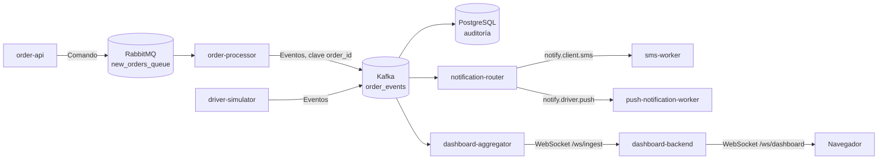

# Rappi-Stream

Plataforma de logística en tiempo real con Java 17, Spring Boot y Maven multimódulo. La fase actual implementa el flujo Kafka → vista del dashboard en memoria → WebSocket, además de la infraestructura local en Docker Compose.

## Flujo previsto



## Requisitos

- Java 17 (Temurin recomendado), Maven 3.9+
- Docker Desktop con Docker Compose v2 en ejecución
- Git y GitHub CLI (`gh`) para contribuir al repositorio

## Inicio rápido

```powershell
git clone https://github.com/oskar-ortiz/Rappi-Stream.git
cd Rappi-Stream
Copy-Item .env.example .env
# Cambia las contraseñas de desarrollo de .env antes de compartir el entorno.
docker compose up -d --build
docker compose ps
mvn -B clean verify
```

El inicio predeterminado construye y ejecuta la infraestructura, `dashboard-backend` y `dashboard-aggregator`. Abre el dashboard en [http://localhost:18080/](http://localhost:18080/); el snapshot JSON está en `/api/orders`. Si el puerto está ocupado, cambia `DASHBOARD_BACKEND_PORT` en `.env`.

Los otros seis servicios están disponibles bajo el perfil `full`. Se mantienen en ese perfil porque aún son esqueletos sin lógica funcional:

```powershell
docker compose --profile full up -d --build
```

Los servicios con Actuator usan `/actuator/health`. Los esqueletos de las Personas A/B que todavía no incluyen Actuator usan `kill -0 1` como healthcheck de proceso; esto confirma que la JVM sigue viva, no que la lógica de negocio esté lista. Como aún no tienen consumidores/listeners que mantengan vivo el proceso, algunos terminan al cerrar el contexto Spring y Compose los reinicia. Sus dependencias de infraestructura sí se esperan healthy mediante `depends_on`; al implementar esos módulos, sus responsables deben validar que el proceso quede estable.

Para validar la integración del dashboard con tres pedidos de humo (requiere Node.js con WebSocket global), inicia primero el cliente en una terminal:

```powershell
docker compose up -d --build
node .\infra\scripts\watch-dashboard.mjs ws://localhost:18080/ws/dashboard
```

En otra terminal, publica los eventos y consulta el snapshot:

```powershell
.\infra\scripts\send-dashboard-smoke-events.ps1
curl.exe http://localhost:18080/api/orders
```

En Git Bash se pueden usar los equivalentes `bash infra/scripts/send-dashboard-smoke-events.sh` y `node infra/scripts/watch-dashboard.mjs ws://localhost:18080/ws/dashboard`. El publicador envía tres eventos por pedido y usa `order_id` como clave Kafka. Compose mantiene los brokers y PostgreSQL solo en la red privada; los únicos puertos de aplicación publicados son el dashboard (`18080`) y `order-api` (`8082`, perfil `full`).

Para apagar los servicios sin borrar los datos persistidos:

```powershell
docker compose down
```

## Estructura

| Ruta | Contenido |
|---|---|
| `order-api/`, `order-processor/` | Recepción y procesamiento de pedidos |
| `driver-simulator/` | Generador de eventos de conductor |
| `notification-router/`, `sms-worker/`, `push-notification-worker/` | Enrutamiento y trabajadores de notificación |
| `dashboard-aggregator/`, `dashboard-backend/` | Agregación e interfaz de dashboard |
| `infra/` | Configuración de Kafka, RabbitMQ y PostgreSQL |
| `docs/` | Contratos, flujo de trabajo y arquitectura |
| `.github/` | CI, plantilla de PR/issue y propietarios del código |

## Equipo y ramas

| Persona | Área y módulos | Rama |
|---|---|---|
| A | Dominio y persistencia: `order-api`, `order-processor`, JPA de `dashboard-aggregator` | `feature/dominio` |
| B | Mensajería: `driver-simulator`, `notification-router`, `sms-worker`, `push-notification-worker` | `feature/mensajeria` |
| C (`@oskar-ortiz`) | Infraestructura, dashboard e integración: `dashboard-backend`, Kafka/WebSocket de `dashboard-aggregator`, Docker/Compose | `feature/infra` |

`dev` es la rama por defecto e integración diaria. El trabajo se propone mediante PR hacia `dev`. `main` está reservada a producción y solo se actualiza mediante PR manual desde `dev`, por la persona encargada.

Los contratos de mensajes y archivos compartidos se rigen por [docs/flujo-de-trabajo.md](docs/flujo-de-trabajo.md). Consulta también [docs/contratos.md](docs/contratos.md) y [docs/arquitectura.md](docs/arquitectura.md).

La vista del aggregator se reconstruye desde el inicio de `order_events` en cada asignación de particiones. La persistencia JPA del historial no está habilitada todavía; `OrderHistoryPort` usa un adaptador de log temporal. Consulta [docs/evidencias-fase2.md](docs/evidencias-fase2.md) para el registro de validaciones de esta fase.

## Estado del repositorio

El repositorio existente se mantuvo con su visibilidad actual (público); no se creó otro repositorio ni se cambió su configuración de privacidad. `dev` es la rama por defecto; `dev` y `main` requieren PR, una aprobación y el check `verify`, y no permiten force-push ni borrado. `dev` exige ramas actualizadas y conversaciones resueltas. GitHub no permite restringir push a usuarios en este repositorio personal; el detalle está en la guía de trabajo. Las contraseñas en `.env.example` son marcadores de desarrollo y deben sustituirse localmente.
