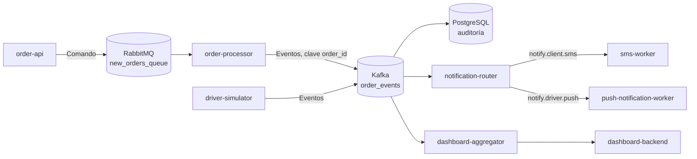

# Rappi-Stream

Base de una plataforma de logística en tiempo real con Java 17, Spring Boot y Maven multimódulo. Esta fase entrega únicamente los esqueletos de los servicios y la infraestructura local; no implementa lógica de negocio.

## Flujo previsto



## Requisitos

- Java 17 (Temurin recomendado), Maven 3.9+
- Docker Desktop con Docker Compose v2 en ejecución
- Git y GitHub CLI (`gh`) para contribuir al repositorio

## Inicio rápido

```powershell
git clone https://github.com/oskar-ortiz/Rappi-Stream.git
cd Rappi-Stream
Copy-Item .env.example .env
# Cambia las contraseñas de desarrollo de .env antes de compartir el entorno.
docker compose up -d
docker compose ps
mvn -B clean verify
```

Para apagar los servicios sin borrar los datos persistidos:

```powershell
docker compose down
```

Las imágenes de aplicación todavía no se incluyen en Compose; los Dockerfiles de cada módulo son una base para incorporarlas cuando se implemente cada servicio.

## Estructura

| Ruta | Contenido |
|---|---|
| `order-api/`, `order-processor/` | Recepción y procesamiento de pedidos |
| `driver-simulator/` | Generador de eventos de conductor |
| `notification-router/`, `sms-worker/`, `push-notification-worker/` | Enrutamiento y trabajadores de notificación |
| `dashboard-aggregator/`, `dashboard-backend/` | Agregación e interfaz de dashboard |
| `infra/` | Configuración de Kafka, RabbitMQ y PostgreSQL |
| `docs/` | Contratos, flujo de trabajo y arquitectura |
| `.github/` | CI, plantilla de PR/issue y propietarios del código |

## Equipo y ramas

| Persona | Área y módulos | Rama |
|---|---|---|
| A | Dominio y persistencia: `order-api`, `order-processor`, JPA de `dashboard-aggregator` | `feature/dominio` |
| B | Mensajería: `driver-simulator`, `notification-router`, `sms-worker`, `push-notification-worker` | `feature/mensajeria` |
| C (`@oskar-ortiz`) | Infraestructura, dashboard e integración: `dashboard-backend`, Kafka/WebSocket de `dashboard-aggregator`, Docker/Compose | `feature/infra` |

`dev` es la rama por defecto e integración diaria. El trabajo se propone mediante PR hacia `dev`. `main` está reservada a producción y solo se actualiza mediante PR manual desde `dev`, por la persona encargada.

Los contratos de mensajes y archivos compartidos se rigen por [docs/flujo-de-trabajo.md](docs/flujo-de-trabajo.md). Consulta también [docs/contratos.md](docs/contratos.md) y [docs/arquitectura.md](docs/arquitectura.md).

## Estado del repositorio

El repositorio existente se mantuvo con su visibilidad actual (público); no se creó otro repositorio ni se cambió su configuración de privacidad. Las contraseñas en `.env.example` son marcadores de desarrollo y deben sustituirse localmente. La protección de ramas y el estado del CI se documentan en la guía de trabajo y deben confirmarse después de configurar GitHub.
