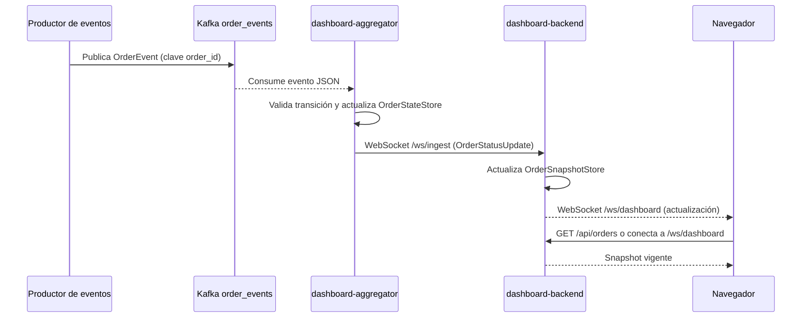

# Arquitectura inicial

El repositorio organiza la plataforma como ocho aplicaciones Spring Boot independientes dentro de un único reactor Maven. La fase de infraestructura implementa el ciclo de lectura de eventos Kafka y publicación del dashboard; los demás módulos siguen siendo esqueletos.

## Componentes y responsabilidades

| Componente | Responsabilidad prevista |
|---|---|
| `order-api` | Recibir solicitudes de pedido y emitir el comando por RabbitMQ |
| `order-processor` | Procesar comandos, producir eventos Kafka y persistir auditoría |
| `driver-simulator` | Simular eventos de asignación, llegada y entrega |
| `notification-router` | Consumir eventos y publicar notificaciones en RabbitMQ |
| `sms-worker` | Consumir notificaciones SMS |
| `push-notification-worker` | Consumir notificaciones push |
| `dashboard-aggregator` | Reconstruir en memoria la vista desde `order_events`, validar transiciones y publicar snapshots por WebSocket |
| `dashboard-backend` | Mantener el último snapshot en memoria, servir la UI/REST y difundir actualizaciones WebSocket a los navegadores |

## Infraestructura y camino de datos

RabbitMQ transporta el comando de creación de pedido por `new_orders_queue` y los mensajes de notificación por el exchange topic `notifications`. Kafka mantiene el registro de eventos `order_events`, particionado por `order_id`. PostgreSQL aloja el esquema `rappi`, que se crea al iniciar la base; las tablas se incorporarán con las entidades JPA en una fase posterior.

En local, Docker Compose levanta ZooKeeper, Kafka, RabbitMQ, PostgreSQL, `dashboard-backend` y `dashboard-aggregator`. `kafka-init` crea el topic al estar Kafka saludable. `rabbitmq-init` aplica las colas y bindings después de que RabbitMQ esté saludable, para conservar el usuario definido por entorno. El aggregator busca el inicio de cada partición en cada asignación y reconstruye una vista idempotente en memoria; envía snapshots al backend por `/ws/ingest`. El backend actualiza su snapshot y publica por `/ws/dashboard`; `GET /api/orders` entrega el estado vigente a clientes tardíos. El dashboard del navegador se sirve en `/`.

Todos los servicios se conectan a una red bridge interna. Una red bridge de borde adicional solo publica el dashboard y `order-api` (perfil `full`) al host. Los servicios de las Personas A y B se declaran con el perfil Compose `full` hasta que implementen su comportamiento. Sus esqueletos sin consumidores/listeners pueden cerrar su contexto Spring y ser reiniciados por Compose; el healthcheck de proceso no representa readiness de negocio. El historial JPA sigue siendo responsabilidad de Persona A; el puerto `OrderHistoryPort` usa por ahora un adaptador de log.

### Secuencia de comunicación del dashboard

El productor de negocio se implementará en los módulos de las Personas A/B; los scripts de humo publican eventos sintéticos con el mismo contrato.

## Responsabilidades del equipo

- **Persona A — `feature/dominio`:** `order-api`, `order-processor` y persistencia JPA de `dashboard-aggregator`.
- **Persona B — `feature/mensajeria`:** `driver-simulator`, `notification-router`, `sms-worker` y `push-notification-worker`.
- **Persona C — `feature/infra`:** `dashboard-backend`, integración Kafka/WebSocket de `dashboard-aggregator`, Docker/Compose y mantenimiento del repositorio.

`dashboard-aggregator` tiene propiedad compartida: acuerden cambios entre A (JPA) y C (Kafka/WebSocket) antes de integrarlos.

## Puntos de sincronización

1. El formato de eventos, comando y payload de notificación se acuerda entre las tres personas antes de cambiar [contratos.md](contratos.md).
2. Los contratos se versionan por PR hacia `dev`; `docs/flujo-de-trabajo.md` define la política de revisión y archivos compartidos.
3. Los cambios de esquema de persistencia deben mantener compatibilidad con los eventos y el dashboard.
4. La infraestructura y los dos servicios del dashboard se levantan por defecto; usa `docker compose --profile full up -d` para iniciar los seis servicios aún sin lógica funcional.
