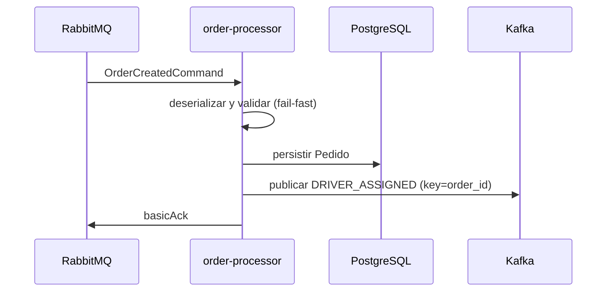

# order-processor

Servicio consumidor de `new_orders_queue`. Valida el comando, persiste el `Pedido` en PostgreSQL, publica el evento `DRIVER_ASSIGNED` en Kafka (`order_events`) y confirma el mensaje RabbitMQ solo después de publicar.

## Flujo

## Política de ack / reject / nack

- Ack manual (`AcknowledgeMode.MANUAL`).
- Mensaje válido: `basicAck` tras publicar en Kafka.
- Mensaje inválido (JSON ilegible o campos inválidos): `basicReject(deliveryTag, false)` (requeue=false) + log con contexto; no persiste ni publica. La cola tiene DLX `new_orders_dlx` / DLQ `new_orders_queue_dlq`.
- Fallo transitorio (BD/Kafka): `basicNack(deliveryTag, false, true)` (requeue=true), sin ack. El contenedor no se reinicia por mensajes inválidos (`defaultRequeueRejected=false`).

## Idempotencia

Deduplicación por `order_id`: `JpaOrderRepositoryAdapter.findById(orderId)`; si existe, no se duplica el pedido. El evento se re-publica en reentregas (el consumidor downstream ignora transiciones inválidas).

## Evento `DRIVER_ASSIGNED`

- Topic: `order_events`.
- Key de partición: `order_id` (string).
- Campos: `event_type="DRIVER_ASSIGNED"`, `order_id`, `driver_id`, `occurred_at` (Instant UTC).
- Serialización JSON, `spring.json.add.type.headers=false`.
- Producer: `acks=all`, idempotencia habilitada, retries.

## Patrones State y Strategy

- `OrderState` (enum): `CREATED` → `DRIVER_ASSIGNED`; transición inválida lanza `InvalidStateTransitionException`.
- `DriverAssignmentStrategy` (interfaz) + `SimpleDriverAssignmentStrategy` (genera `driver-<uuid>`). Inyectada por constructor.

## Health indicators

- `rabbitListener`: contenedor RabbitMQ activo (`running`).
- `db`: conexión PostgreSQL (Spring Boot).
- `kafka`: `AdminClient.describeCluster()` con timeout de 5 s.
- Grupo de readiness: `management.endpoint.health.group.readiness.include=rabbitListener,db,kafka`.
- Detalle controlado por `MANAGEMENT_ENDPOINT_HEALTH_SHOW_DETAILS` (por defecto `never`).

## Variables de entorno

| Variable | Descripción | Por defecto |
|---|---|---|
| `SPRING_KAFKA_BOOTSTRAP_SERVERS` | Brokers Kafka | `localhost:9092` |
| `KAFKA_TOPIC` | Topic de eventos | `order_events` |
| `SPRING_RABBITMQ_HOST/PORT/USERNAME/PASSWORD` | RabbitMQ | `localhost`/`5672`/`rappi`/`change-me` |
| `NEW_ORDERS_QUEUE` | Cola de comandos | `new_orders_queue` |
| `SPRING_DATASOURCE_URL/USERNAME/PASSWORD` | PostgreSQL | `jdbc:postgresql://localhost:5432/rappistream` / `rappi` / `change-me` |
| `MANAGEMENT_ENDPOINT_HEALTH_SHOW_DETAILS` | Detalle del health | `never` |

## Limitaciones conocidas

- Ventana de inconsistencia persistir/publicar: si falla Kafka tras persistir, el mensaje se reentrega y se re-publica (idempotencia evita duplicar pedido). Evolución futura: patrón outbox.
- `spring.jpa.hibernate.ddl-auto=update` (ver nota a Oskar).
- `SimpleDriverAssignmentStrategy` genera un driver aleatorio por pedido (no hay pool real de repartidores en este módulo).

Ver también: [contratos.md](contratos.md), [order-api.md](order-api.md), [persistencia-historial.md](persistencia-historial.md).
